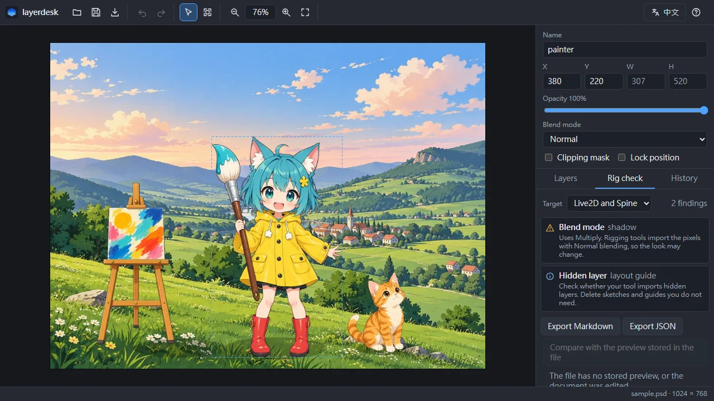

# layerdesk

**Open a PSD, move its layers around, save it back. Offline, in your browser.**

layerdesk is an offline-first layer editor for PSD files that runs entirely in the browser. Drag in a PSD to see every layer, then move, scale, rotate, hide, reorder and group them, and save the result as a PSD again or export PNG images. A check panel points out layers that tend to break when the file is imported into Live2D Cubism or Spine.

[繁體中文](#繁體中文) | [English](#english)



**Try it: https://zzoraemon043.github.io/layerdesk/**

> Status: first release. The design is in [docs/spec.md](docs/spec.md).

---

## English

### Why

Small fixes to a layered artwork, such as nudging an arm, renaming parts or hiding a sketch layer, usually mean opening a large desktop image editor or uploading the file to an online service. layerdesk opens the PSD in a browser tab, lets you rearrange the layers and saves it back. Your files stay on your machine.

It is also built for people who cut artwork into parts for rigging. Before you import a PSD into Live2D Cubism or Spine, the check panel lists layers with blend modes, clipping masks, effects or names that the rigging tool will not handle the way you expect.

### Features

- Open PSD files by drag and drop and show the full layer tree with thumbnails
- Move layers by dragging, and scale or rotate them with transform handles
- Show and hide layers, change opacity and blend mode, rename, reorder, group and ungroup
- Undo and redo for every edit
- Zoom and pan the canvas
- Save as PSD, export the composite as PNG, or export every layer as PNG in a ZIP
- Rigging check panel for Live2D Cubism and Spine
- Installable as a PWA and fully usable offline
- Interface in Traditional Chinese and English

### Limitations

- Painting, selections, filters and text editing are not part of the first release.
- Layer effects, adjustment layers, smart object contents and text are shown from the pixels stored in the file and are not re-rendered.
- Files with 16 or 32 bits per channel, or not in RGB mode, can be viewed, edited and exported to PNG, but not saved back as PSD.
- A layer that is scaled or rotated is saved as a plain pixel layer. If it was a text, smart object or shape layer, layerdesk asks before saving.

### Development

```
npm install
npm run dev
npm test
npm run test:e2e
npm run build
```

### License

[MIT](LICENSE)

layerdesk is an independent project and is not affiliated with Adobe, Live2D or Esoteric Software.

---

## 繁體中文

**打開 PSD，拖動圖層，存回去。離線，在瀏覽器裡完成。**

**線上試用：https://zzoraemon043.github.io/layerdesk/**

layerdesk 是完全在瀏覽器中執行、離線優先的 PSD 圖層編輯器。把 PSD 拖進來就能看到所有圖層，可以移動、縮放、旋轉、隱藏、調整順序、建立群組，再存回 PSD 或匯出 PNG。檢查面板會列出匯入 Live2D Cubism 或 Spine 時容易出問題的圖層。

### 為什麼需要它

只是想把手臂挪一點、改幾個圖層名稱、把草稿圖層藏起來，通常也得打開大型的影像編輯軟體，或把檔案上傳到線上服務。layerdesk 在瀏覽器分頁中直接打開 PSD，調整完圖層就能存回去，檔案始終留在你的電腦上。

它也是為拆件的人設計的。把 PSD 匯入 Live2D Cubism 或 Spine 之前，檢查面板會列出混合模式、剪裁遮色片、圖層樣式或名稱可能不會照你預期處理的圖層。

### 功能

- 拖放開啟 PSD，顯示完整圖層樹與縮圖
- 拖曳移動圖層，用變形控制點縮放、旋轉
- 顯示／隱藏圖層、調整不透明度與混合模式、重新命名、調整順序、建立與解散群組
- 每個操作都能復原、重做
- 縮放、平移畫布
- 存成 PSD、把合成結果匯出為 PNG，或把每個圖層匯出為 PNG 打包成 ZIP
- Live2D Cubism 與 Spine 拆件檢查面板
- 可安裝為 PWA，完全離線使用
- 繁體中文與英文介面

### 限制

- 第一版不包含畫筆、選取範圍、濾鏡、文字編輯。
- 圖層樣式、調整圖層、智慧型物件內容與文字，會以檔案內儲存的像素顯示，不會重新計算。
- 每色版 16 或 32 位元、或不是 RGB 模式的檔案，可以檢視、編輯、匯出 PNG，但不能存回 PSD。
- 縮放或旋轉過的圖層會存成一般點陣圖層；如果原本是文字、智慧型物件或形狀圖層，儲存前會先詢問。

### 開發

```
npm install
npm run dev
npm test
npm run test:e2e
npm run build
```

### 授權

[MIT](LICENSE)

layerdesk 是獨立專案，與 Adobe、Live2D、Esoteric Software 沒有任何關係。
